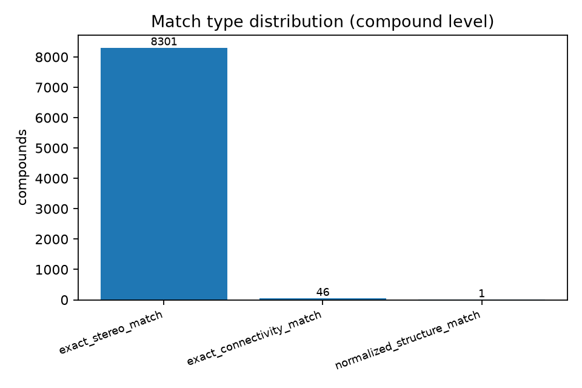
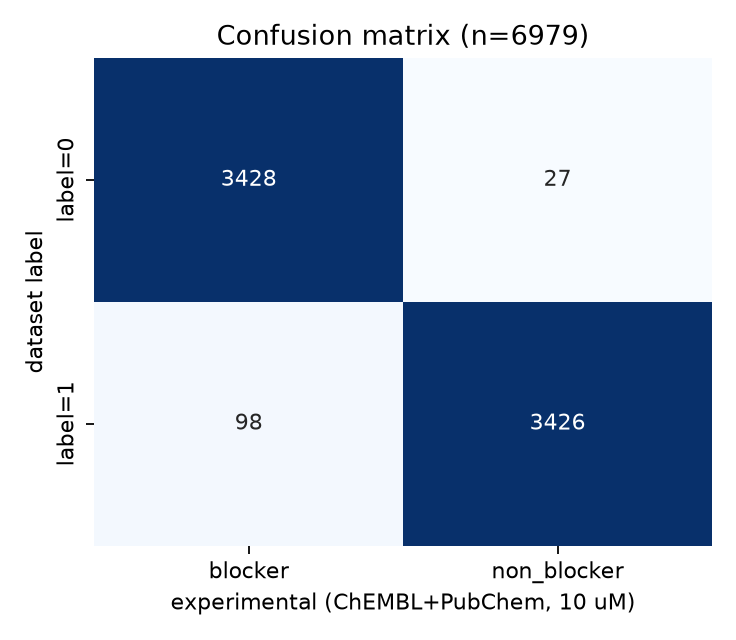
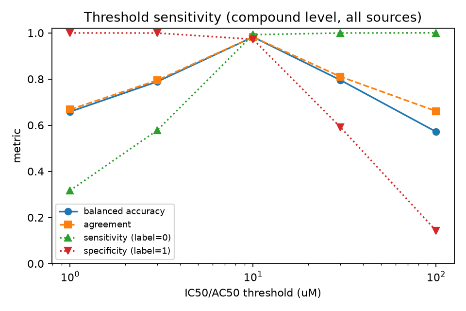
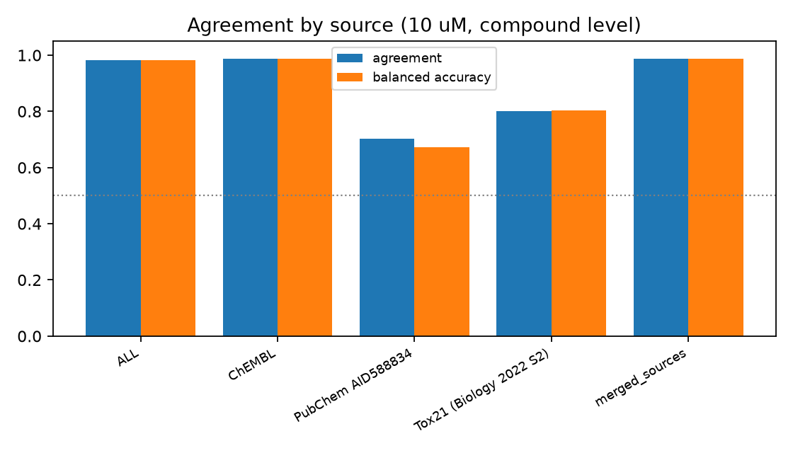
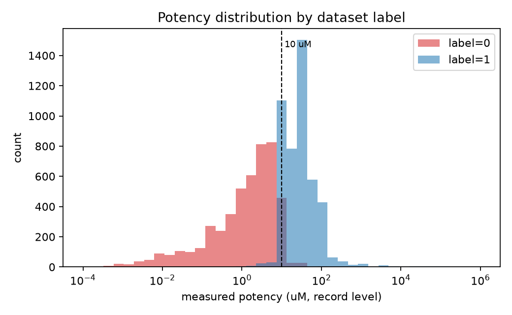
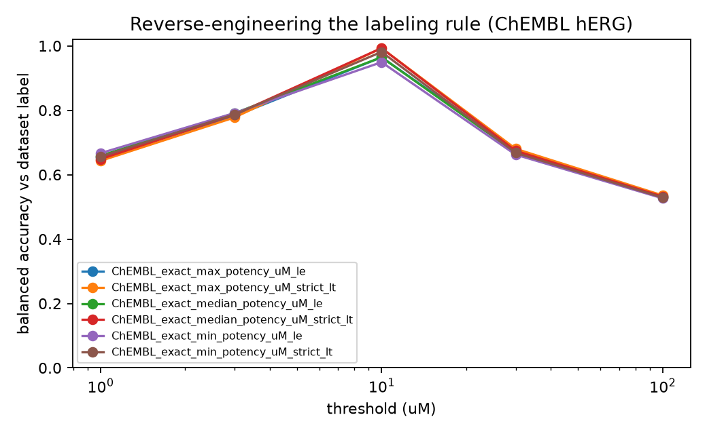
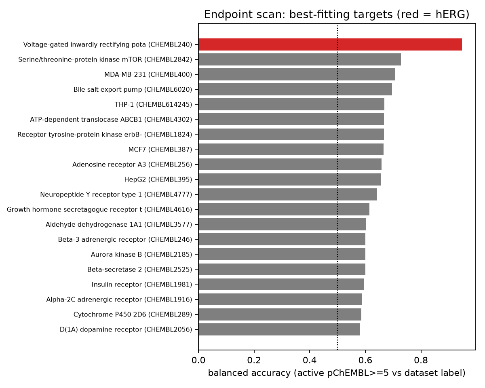
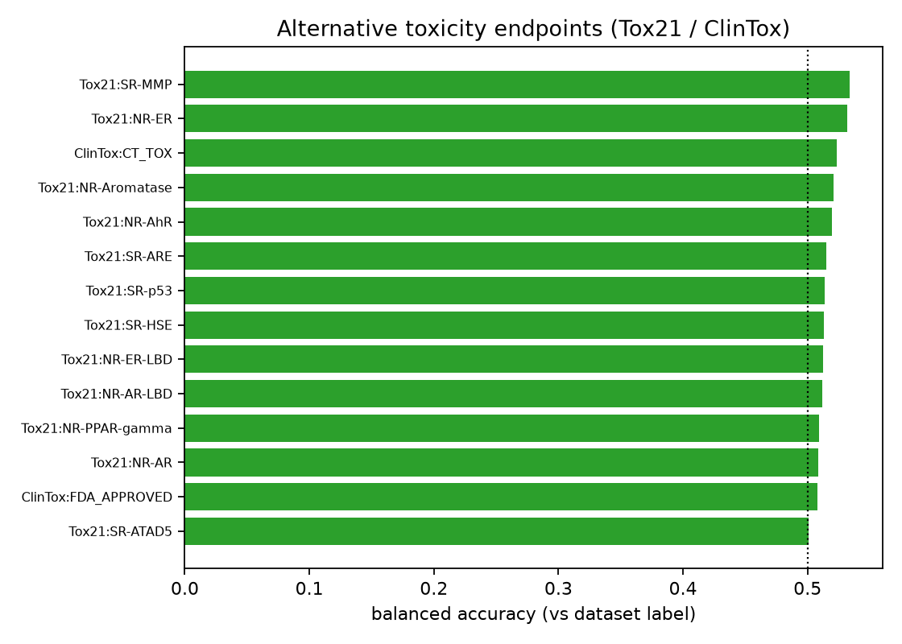

# hERG 독성 라벨 검증 보고서

- 대상: `data/train.csv` (8,349행 × 3,078열), 고정 라벨 정의 **`label = 0`: 독성 / `label = 1`: 비독성**
- 검증 질문: `label`이 **hERG(human ERG, KCNH2) 칼륨 채널 차단 활성**을 의미하는가
- 외부 실험 데이터: ChEMBL `CHEMBL240`(hERG) activity 전량, PubChem BioAssay `AID588834`(Tox21/NCGC hERG thallium flux), 논문 보충자료(Tox21 hERG qHTS), ChEMBL 다중 타깃 activity, Tox21 12-endpoint 패널, ClinTox
- 실행 코드: `herg_validation/validation.py` · 출처/라이선스: `DATA_SOURCES.md` · 재현: `README.md`
- 조회일: 2026-10-20

---

## 0. 결론 요약

| 항목 | 결과 |
|---|---|
| 구조 매칭률 | **8,348 / 8,349행 (99.99%)** — 8,301개가 입체화학까지 일치(`exact_stereo_match`) |
| 주 분석(10 µM, 화합물 단위 출처통합) | 일치율 **98.64%**, 민감도 99.9%, 특이도 97.4%, balanced accuracy 0.987 (95% CI 0.984–0.989), 순열검정 p < 1×10⁻⁴ |
| 레코드 단위(분자×assay) | 일치율 95.6%, balanced accuracy 0.957 (0.953–0.960) |
| ChEMBL 단독(엄격 `<10 µM`) | 일치율 **99.96%**, balanced accuracy 0.9996 (0.9987–0.9999), 잔여 불일치 3건 |
| 라벨 방향 | **확인됨.** `label=0` ↔ hERG 차단 활성, `label=1` ↔ 차단 활성 낮음 |
| 독립 소스만 사용(ChEMBL 제외, n=87) | 일치율 79.3% (95% CI 69.7–86.5), balanced accuracy 0.797, p < 1×10⁻⁴ |
| 종말점 특이성 | ChEMBL 다중 타깃 157개 중 hERG가 1위(BA 0.948, `pChEMBL≥5` 기준). Tox21 12-endpoint·ClinTox는 모두 무관(최대 BA 0.534, BH q ≥ 0.57) → **더 적합한 대체 종말점을 찾지 못함** |
| **최종 판정** | **`supported_with_limitations`** |

**판정 근거(요약).** 라벨의 *방향*은 명확히 hERG 차단 활성과 일치하며, 반증적 검정(대체 종말점, 라벨 순열)에서도 hERG 가설이 가장 잘 지지된다. 그러나 **일치율의 대부분은 출처 동일성에서 비롯된다.** 대상 데이터셋 화합물의 99.4%가 ChEMBL hERG 기록과 정확히 일치하고, 라벨은 ChEMBL 값을 "10 µM 미만 = 활성" 규칙으로 집계하면 **99.5~99.96% 재현**된다. 즉 다중 assay·다중 화합물군의 *독립적* 실험으로 얻은 높은 일치율이 아니라, 대상 라벨이 애초에 ChEMBL hERG 편집본에서 유래했을 가능성이 매우 높다. ChEMBL을 제외한 진짜 독립 데이터는 87~90개 화합물(주로 thallium flux)뿐이며 일치율은 79~80%로 낮아진다. 따라서 "강하게 지지됨"이 아니라 **한계를 동반한 지지**로 판정한다.

---

## 1. 검증 대상과 라벨 정의

지시문에 따라 라벨 정의는 고정했고 코드에서도 상수로만 사용했다.

```python
LABEL_TOXIC = 0      # 독성  -> hERG 차단 활성 기대
LABEL_NONTOXIC = 1   # 비독성 -> hERG 차단 활성 낮음 기대
```

양성 클래스는 **hERG blocker**로 정의했으므로 `label=0`이 양성이다. 혼동행렬의 TP = `label=0` & 실험 blocker, FN = `label=0` & 실험 non-blocker, FP = `label=1` & 실험 blocker, TN = `label=1` & 실험 non-blocker.

---

## 2. 방법

### 2.1 입력 데이터 확인 (§2)

| 항목 | 값 |
|---|---:|
| 행 수 | 8,349 |
| 컬럼 수 | 3,078 (`SMILES` 1 + ECFP/FCFP/PTFP 각 1,024 + `MolWt`, `clogp`, `sa_score`, `qed` + `label`) |
| 고유 SMILES | 8,349 (중복 없음) |
| 결측치 | 0 |
| 라벨 분포 | `1`(비독성) 4,542 (54.4%) / `0`(독성) 3,807 (45.6%) |
| RDKit 파싱 실패 | **0** |
| 염/혼합물(`.` 포함) | 262 |
| 입체화학 표기(`@`, `/`, `\`) | 3,948 |
| canonical SMILES가 원본과 다른 행 | 8,148 |
| tautomer 정규화로 구조가 바뀐 행 | 1,489 |
| 고유 구조 키 | InChIKey 8,322 / connectivity block 8,025 / 정규화 InChIKey 8,266 |

정규화 수준별 고유 키 수가 다르다는 것은 염 제거·tautomer·입체화학 처리가 실제로 매칭 결과를 바꿀 수 있음을 뜻한다. 따라서 매칭은 **계층적으로** 수행하고, 각 수준을 `match_type`으로 구분해 기록했다.

### 2.2 구조 매칭 (§4)

1. `exact_stereo_match`: 표준 InChIKey(27자) 완전 일치
2. `exact_connectivity_match`: InChIKey 첫 블록(14자)만 일치 → 입체화학 정보가 다르거나 없음
3. `normalized_structure_match`: 최대 fragment 선택(탈염) → 전하 중성화 → tautomer canonical화 후 InChIKey 일치
4. `similarity_only`: ECFP4(Morgan r=2, 2048bit) Tanimoto ≥ 0.90 — **주 분석에서 제외**하고 별도 기록 (이번 데이터에서는 해당 사례 0건)

염/이온화 상태 차이는 `salt_flag_dataset`, `salt_flag_external`로 별도 플래그를 남겼고, ChEMBL molecule ID·PubChem CID로 교차 확인했다. 원본 `dataset_row_index`와 `original_smiles`는 모든 결과 테이블에 보존했다.

### 2.3 외부 실험 데이터 (§3)

| 소스 | 규모 | 성격 |
|---|---:|---|
| ChEMBL `CHEMBL240` (hERG, H. sapiens) | activity 41,078건 / assay 4,829건 | assay_type: 결합 B 32,640 · 독성 T 4,390 · 기능 F 3,597 · ADME A 451 |
| PubChem `AID588834` (Tox21/NCGC qHTS thallium flux, U2OS) | 5,384 레코드 | 세포 기반 기능 시험, AC50/%inhibition |
| 논문 보충자료 S2 (Krishna et al. 2022, Tox21 hERG qHTS) | 7,871 화합물 (활성 896) | Tox21 라이브러리 hERG 스크리닝 |
| ChEMBL 다중 타깃 activity | 66,197건 / 157 타깃 | 종말점 탐색용 |
| Tox21 12-endpoint, ClinTox | 7,831 / 1,484 화합물 | 대체 종말점 대조 |

측정 방식은 `assay_group`으로 분리해 **합치지 않았다**: `binding`, `patch_clamp_electrophysiology`, `thallium_flux`, `membrane_potential_fluorescence`, `functional_other`, `toxicity_other`.

ChEMBL hERG activity는 `standard_type`이 매우 이질적이다(IC50 19,130 · Inhibition 7,808 · Ki 3,689 · kon/k_off 각 2,946 · AC50 1,823 · Potency 679 · Activity 551 · EC50 253 등). 동역학 상수(`kon`/`k_off`)·변이체 비교값(`delta pIC50 wt-mutant`)·단순 `Activity`는 차단 활성 지표로 변환하지 않고 제외했다. 단위도 `nM` 22,877 · `%` 8,098 · 결측 6,563 · `s-1` 2,946 등으로 혼재해, 단위·타입이 변환 불가한 레코드는 `unknown`으로 남겼다.

논문 보충자료는 MDPI 링크가 403으로 막혀 있었으나 Europe PMC 보충파일 경로로 확보했다(성공/실패 전 과정은 `DATA_SOURCES.md` §3과 `cache/supplement_attempts.json`에 기록). 이 과정에서 보충자료 S2의 활성값이 **표준 pIC50(mol/L 기준)**임을 문헌값 대조로 확인했다(vanoxerine pIC50 7.12 → IC50 0.076 µM). 최초 변환식이 틀렸음을 발견해 수정했고, 수정 내역은 코드 주석에 남겼다.

### 2.4 실험값 → 이진 클래스 (§5)

- 주 기준: **IC50(또는 AC50/EC50/Ki 등 potency 계열) ≤ 10 µM → hERG 차단 활성**
- 민감도 분석: 1 / 3 / 10 / 30 / 100 µM 및 `pChEMBL ≥ 5`
- 검열 측정값(`>`, `<`, `≥`, `≤`): 정확값으로 취급하지 않고 임계값 대비 방향만 사용. 판정이 불가능한 경우 `ambiguous_censored`
- `% inhibition` 단독 측정: IC50로 환산하지 않고 **별도 클래스**(`class_pct_*`, 규칙 `≥50%`)로 분리 보고
- assay 간 결과가 상충하면 `ambiguous`로 유지(단일 값으로 축약하지 않음), 자료가 없으면 `unknown`

### 2.5 통계 (§7)

- 행(레코드) 단위와 **고유 화합물 단위** 통계를 분리 — 반복 assay를 독립 표본으로 부풀리지 않음
- 일치율·민감도·특이도·정밀도·balanced accuracy, **Wilson 95% CI**
- 95% CI 추가 보정: Bemis–Murcko 스캐폴드 클러스터 부트스트랩(2,000회)
- **라벨 순열검정**(10,000회)으로 우연 일치 가능성 검토
- 화합물 단위 집계는 potency 계열 레코드만 사용

### 2.6 반증적 종말점 탐색 (사용자 요구사항)

1. 역방향 검정(`label=1` = blocker 가정)과 비교
2. **라벨링 규칙 역추적**: ChEMBL hERG 값의 집계 방식(최소/중앙/최대) × 임계값 × 비교연산자 조합으로 대상 라벨을 얼마나 재현하는지 계산
3. **ChEMBL 다중 타깃 스캔**: 대상 화합물과 중첩되는 157개 타깃에 대해 "타깃 활성 ↔ 데이터 라벨" 연관도를 balanced accuracy로 순위화(순열 p, Benjamini–Hochberg q)
4. **Tox21 12-endpoint + ClinTox**: hERG 이외 독성 종말점과의 일치율 비교

---

## 3. 결과

### 3.1 매칭 결과 (§4)

| 항목 | 값 |
|---|---:|
| 매칭된 행 | **8,348 / 8,349 (99.99%)** |
| 미매칭 행 | 1 (row 1559, benzisoxazole 유도체 — 외부 hERG 데이터 없음) |
| 화합물 단위 매칭 유형 | `exact_stereo_match` 8,301 · `exact_connectivity_match` 46 · `normalized_structure_match` 1 |
| 분자–레코드 쌍 | 12,210 |
| 소스별 레코드 | ChEMBL 12,009 · PubChem AID588834 110 · Tox21 S2 91 |
| `similarity_only` | 0 |

정규화(탈염·중성화·tautomer)로만 매칭된 화합물은 1건, 입체화학을 무시해야 매칭된 화합물은 46건이었다. 염 제거나 tautomer 처리가 매칭률을 크게 바꾸지는 않았지만 46건에서는 `label` 해석에 영향을 줄 수 있어 별도로 표시했다.

화합물 단위 실험 클래스 분포(10 µM 기준): `blocker` 3,449 · `non_blocker` 3,382 · `unknown` 1,371 · `ambiguous` 146.

- `unknown` 1,371건 중 1,165건은 `% inhibition` 단독 측정만 존재(별도 분석), 220건은 potency 계열이지만 단위/타입이 변환 불가
- `ambiguous` 146건은 assay 간 결과가 상충



### 3.2 주 분석 — 10 µM, 화합물 단위 (§6, §7)

분석 단위를 명확히 구분해 보고한다. 반복 assay를 독립 표본으로 부풀리지 않기 위해 **화합물 단위(출처 통합, 중복 제거)** 를 주 결과로 삼는다.

| 분석 단위 | n | 일치율 (95% CI) | 민감도 | 특이도 | balanced accuracy (95% CI) | 혼동행렬 |
|---|---:|---:|---:|---:|---:|---|
| **화합물 단위 (출처 통합, 중복 제거)** | **6,831** | **98.64%** (98.34–98.89) | 99.94% | 97.38% | **0.9866** (0.9835–0.9890) | TP 3,358 · FN 2 · FP 91 · TN 3,380 |
| 화합물×출처 단위 | 6,979 | 98.21% (97.87–98.49) | 99.22% | 97.22% | 0.9822 (0.9789–0.9851) | TP 3,428 · FN 27 · FP 98 · TN 3,426 |
| 레코드 단위 (분자×assay) | 11,011 | 95.61% (95.21–95.98) | 96.54% | 94.76% | 0.9565 (0.9525–0.9602) | TP 5,104 · FN 183 · FP 300 · TN 5,424 |

- 스캐폴드 클러스터 부트스트랩(2,000회, 3,463 클러스터) 95% CI: balanced accuracy **0.9835–0.9894**
- 순열검정(10,000회): **p < 1×10⁻⁴** (우연 기대 BA 0.500 ± 0.006)
- `label=0`(독성) 3,360건 중 3,358건이 실험적으로 blocker(99.94%), `label=1`(비독성) 3,471건 중 3,380건이 non-blocker(97.38%)



화합물×출처 단위보다 통합 단위에서 성능이 더 높은 이유는, 서로 다른 출처에서 결과가 상충하는 화합물이 통합 시 `ambiguous`로 빠지기 때문이다(§3.8). 레코드 단위 성능이 가장 낮은 것은 반복 측정의 분산을 그대로 반영한 결과다.

보조 검토로, 10 µM 경계에서 정확히 10,000 nM로 측정된 화합물 **614건 중 608건이 `label=1`(비독성), 6건만 `label=0`**이었다. 이는 대상 데이터셋이 `≤10 µM`가 아니라 **`<10 µM`** 규칙을 쓴 정황이다. 실제로 비교연산자를 `<`로 바꾸면 ChEMBL 근거만으로 일치율 **99.96%**(TP 3,366 · FN 2 · FP 1 · TN 3,501)가 된다.

### 3.3 임계값 민감도



| 임계값 | 일치율 | balanced accuracy | 민감도 | 특이도 |
|---:|---:|---:|---:|---:|
| 1 µM | 66.8% | 0.658 | 0.317 | 1.000 |
| 3 µM | 79.5% | 0.789 | 0.578 | 0.999 |
| **10 µM** | **98.2%** | **0.982** | 0.992 | 0.972 |
| 30 µM | 81.0% | 0.795 | 0.999 | 0.592 |
| 100 µM | 66.1% | 0.571 | 1.000 | 0.143 |

(화합물×출처 단위, 전체 소스. 통합·중복제거 단위로는 10 µM에서 일치율 98.64%, 엄격 `<10 µM`에서 99.96%.)

10 µM에서 뾰족하게 최대가 되고 1 µM·30 µM에서는 급격히 떨어진다. 즉 라벨은 10 µM 부근의 **단일 임계값**을 전제로 만들어졌으며, "어떤 임계값이든 통하는" 결과가 아니다.

### 3.4 측정 방식(assay)별 — 합치지 않고 분리

| assay_group | 화합물 수 | 일치율 | balanced accuracy |
|---|---:|---:|---:|
| binding | 5,309 | 98.3% | 0.984 |
| patch_clamp_electrophysiology | 2,830 | 97.4% | 0.976 |
| membrane_potential_fluorescence | 31 | 96.8% | 0.978 |
| toxicity_other | 78 | 96.2% | 0.958 |
| thallium_flux | 290 | 92.1% | 0.913 |
| functional_other | 134 | 84.3% | 0.840 |



전기생리학(patch clamp)과 결합(binding) 데이터는 잘 맞지만, 세포 기반 고속 스크리닝 계열(thallium flux)은 일치율이 낮다. 같은 hERG라도 **측정 원리와 프로토콜에 따라 결과가 달라진다**는 점이 정량적으로 드러났다. 결합 assay가 전체의 62%를 차지하므로, "hERG IC50/Ki"라는 단일 종말점으로 묶는 것 자체가 하나의 단순화임을 유의해야 한다.

### 3.5 독립 소스만 사용한 검증 (핵심 한계 검정)

ChEMBL을 완전히 배제하고 독립 소스(PubChem AID588834, Tox21 S2)만 사용한 결과:

| 분석 | 표본 | 일치율 (95% CI) | balanced accuracy | 순열 p |
|---|---:|---:|---:|---:|
| 독립 소스 통합 (potency 우선, 없으면 %inhibition ≥50%) | **87** | 79.3% (69.7–86.5) | 0.797 | < 1×10⁻⁴ |
| Tox21 S2 단독 (10 µM) | 90 | 80.0% (70.6–87.0) | 0.802 | < 1×10⁻⁴ |
| PubChem AID588834 단독 (10 µM) | 47 | 70.2% (56.0–81.4) | 0.672 | 0.073 (유의하지 않음) |

- 방향은 유지된다(민감도 0.69, 특이도 0.90). 즉 라벨=0 화합물이 독립 assay에서도 차단 활성을 보이는 경향은 우연과 구분된다(p < 1×10⁻⁴).
- 그러나 **일치율은 79~80%로 떨어지고**, PubChem 단독 분석(n=47)은 95% CI가 0.5를 포함해 유의하지 않다.
- 표본이 전체의 약 1%에 불과하다. Tox21 라이브러리는 환경화학물질 비중이 높아 대상 데이터셋(drug-like, ChEMBL 유래)과 화학 공간이 겹치는 부분이 적다.
- PubChem과 S2는 모두 **thallium flux** 계열이다. 서로 다른 assay 원리의 독립 데이터(예: patch clamp 전용 독립 데이터셋)는 거의 확보되지 않았다.



### 3.6 순환성 검정 — 라벨링 규칙 역추적

ChEMBL hERG의 potency 값만으로 대상 라벨을 재현해 보았다(정확값 `=` 레코드만 사용, 5,254 화합물).

| 집계 | 임계값 | 비교 | 정확도 | balanced accuracy |
|---|---:|---|---:|---:|
| 중앙값 | 10 µM | `<` | **0.9945** | 0.9930 |
| 최대값 | 10 µM | `<` | 0.9924 | 0.9930 |
| 최소값 | 10 µM | `<` | 0.9865 | 0.9813 |
| 중앙값 | 10 µM | `≤` | 0.9741 | 0.9646 |
| pChEMBL ≥ 5 | 10 µM | — | 0.9640 | 0.9480 |
| 결합 규칙(potency 최소 `<10 µM` **또는** %inhibition ≥50%) | 10 µM | — | 0.9838 (전체 8,348 화합물) | 0.9851 |



**해석.** 단순한 규칙 하나로 대상 라벨의 98~99.5%가 재현된다. 이는 (a) 라벨이 실제로 hERG 데이터에 근거한다는 증거인 동시에, (b) **ChEMBL과의 일치율이 독립적인 재현이 아니라 출처 동일성의 결과**임을 강하게 시사한다. `% inhibition ≥50%` 규칙까지 포함하면 `% inhibition` 단독 측정 화합물(1,125건, 일치율 98.0%)까지 설명되므로, 대상 데이터셋은 ChEMBL hERG 기록을 임계값 규칙으로 이진화한 편집본일 가능성이 높다.

### 3.7 종말점 탐색 — "hERG보다 더 적합한 종말점이 있는가"

**(a) ChEMBL 다중 타깃 스캔 (157 타깃, 화합물 ≥30)**

| 타깃 | 이름 | 화합물 | balanced accuracy | BH q | 비고 |
|---|---|---:|---:|---:|---|
| **CHEMBL240** | **hERG / KCNH2** | **5,107** | **0.948** | 0.078 | 1위 |
| CHEMBL2842 | mTOR | 67 | 0.728 | 0.078 | 2위, 방향은 반대 |
| CHEMBL400 | MDA-MB-231 세포주 | 34 | 0.706 | 0.188 | |
| CHEMBL6020 | BSEP | 49 | 0.696 | 0.118 | |
| ... | (이하 0.67 이하) | | | | |

hERG가 표본 규모(5,107)와 성능(0.948) 모두에서 압도적 1위이며, 2위 이하는 표본이 30~77건에 불과하고 방향도 "활성 = 비독성"(음성 상관)인 경우가 대부분이다. 즉 **대상 라벨을 hERG보다 잘 설명하는 다른 ChEMBL 타깃은 발견되지 않았다.**

> 표준화를 위해 스캔에서는 `pChEMBL ≥ 5`(≈ IC50 ≤ 10 µM, `≤` 규칙)를 활성으로 정의했다. 이 규칙이 주 분석의 엄격 `<10 µM`보다 경계 화합물을 많이 활성으로 분류하므로 BA가 0.948로 다소 낮게 나온다(같은 데이터에 `<10 µM`를 적용하면 0.9996). 타깃 간 비교는 동일 규칙으로 이루어졌으므로 순위 해석에는 영향이 없다.



**(b) Tox21 12-endpoint 패널 + ClinTox (독립 데이터)**

14개 종말점 중 최고 balanced accuracy가 **0.534**(SR-MMP)에 불과했고, 모든 BH q ≥ 0.565로 유의하지 않았다. 임상시험 독성(`CT_TOX`)도 BA 0.524로 무관했다. 즉 라벨은 일반 독성·세포독성·핵수용체 활성 종말점으로 설명되지 않는다.



**(c) 역방향 가설.** `label=1`을 blocker로 가정하고 예측을 뒤집으면 주 분석(10 µM, 화합물 단위)에서 balanced accuracy가 **0.982 → 0.018** 로 붕괴한다(민감도 0.008, 특이도 0.028). 라벨 방향이 반대일 가능성은 지지되지 않는다.

**종합.** hERG 가설은 반증 시도를 견뎠고, 대체 종말점은 더 나은 설명을 제공하지 못했다. 다만 (a)의 결과는 "라벨이 hERG에서 파생되었다"는 사실을 다시 확인해 주는 측면도 있다.

### 3.8 불일치 분석 (§8)

주 분석(10 µM, 통합 소스)에서 불일치는 **93건**(`label=1` 91건, `label=0` 2건)이었다.

| 원인 | 건수 | 설명 |
|---|---:|---|
| `measurement_near_threshold` | 92 | 측정값이 정확히 10,000 nM = 10 µM. 그중 608건이 `label=1`로 인코딩됨(§3.2). 임계값 비교연산자(`≤` vs `<`) 처리 차이 |
| `unexplained` | 1 | row 5517: `label=0`인데 ChEMBL binding IC50 41.3 / 82.6 µM (다른 assay 없음) |

`<10 µM` 규칙을 적용하면 잔여 불일치는 3건으로 줄어든다.

| row | `label` | 실험 근거 | 사유 |
|---:|---:|---|---|
| 5517 | 0 | IC50 41.3 / 82.6 µM (binding) | 실험값과 라벨이 실제로 상충 |
| 5893 | 0 | `>10 µM` (검열값, binding) | 검열값이라 활성 여부 확정 불가 |
| 6851 | 1 | `<10 µM` (검열값, binding) | 검열값이라 활성 여부 확정 불가 |

추가로 검토한 항목:

- **임계값 근접**: 92건 모두 경계값(10 µM) 사례로 설명됨
- **assay 상충**: 146개 화합물이 `ambiguous`로 분류됨(단일 값으로 축약하지 않음). 최소/최대 측정값이 0.0001 µM ~ 4,400 µM까지 벌어진 사례도 있어, 출처 assay의 단위·조건 차이가 큼
- **SMILES/tautomer/염/입체화학**: 46건이 `exact_connectivity_match`(입체화학 미일치). 염 형태 차이는 262건에서 플래그되었으나 매칭 실패로 이어진 사례는 없음
- **라벨 인코딩**: §3.2·§3.6에서 확인된 `<` vs `≤` 경계 처리 차이가 가장 큰 불일치 원인
- **다른 종말점 유래 가능성**: §3.7(b)에서 기각(Tox21·ClinTox 무관)
- **예측값/정성 서술 사용 여부**: 모든 판정은 데이터베이스에 등록된 실측값(IC50·Ki·AC50·%inhibition)만 사용했고, 예측값은 사용하지 않음

`label_conflicts.csv`에 93건 전체와 사유를, `excluded_cases.csv`에 제외 사례(미매칭 1건)를 기록했다.

### 3.9 보조 구조특성 분석 (§9, 보조 증거)

전체 8,349 화합물과, 실험 클래스가 확인된 6,831 화합물에서 각각 특성 분포를 비교했다.

| 특성 | `label=0` 평균 | `label=1` 평균 | rank AUC (독성↑) | 실험 클래스 기준 AUC (blocker↑) |
|---|---:|---:|---:|---:|
| clogP | 4.21 | 3.45 | **0.663** | **0.668** |
| TPSA | 70.2 | 85.1 | 0.360 | 0.357 |
| 염기성 아민 수 | 0.90 | 0.75 | 0.569 | 0.578 |
| QED | 0.542 | 0.573 | 0.452 | 0.439 |
| HBD | 1.14 | 1.45 | 0.412 | 0.399 |
| MolWt | 443.8 | 442.8 | 0.505 | 0.515 |

방향은 hERG 차단제의 알려진 물성 경향(높은 지용성·낮은 TPSA·염기성 아민 존재)과 일치하고, **라벨 기준과 실험 클래스 기준이 같은 방향**을 보인다. 다만 단일 물성만으로 개별 화합물의 라벨을 결정할 수는 없으며(AUC ≤ 0.67), 이 분석은 보조 증거로만 사용한다.

---

## 4. 한계와 남은 모순

1. **순환성(가장 중요).** 대상 화합물의 99.4%가 ChEMBL hERG 기록과 입체화학까지 일치하며, 라벨이 단순 임계값 규칙으로 98~99.5% 재현된다. 따라서 ChEMBL을 이용한 일치율은 "독립 재현"이 아니라 "출처 확인"에 가깝다. 이 보고서는 두 성격을 분리해 제시했다(§3.2 vs §3.5).
2. **독립 표본의 크기.** ChEMBL을 배제한 독립 데이터는 87~90개 화합물뿐이다. 일치율 79~80%는 우연과 구분되지만(p < 1×10⁻⁴) 95% CI가 0.70~0.87로 넓고, PubChem 단독(n=47)은 유의하지 않다.
3. **assay 편향.** 근거의 62%가 결합(binding), 33%가 patch clamp이며 세포 기반 고속 스크리닝은 8% 미만이다. 결합 assay의 IC50/Ki를 "hERG 기능 억제"와 동일시하는 것은 근사이며, 측정 방식별 일치율 차이(0.84~0.98)가 이를 보여준다.
4. **임계값·집계 규칙 민감성.** 10 µM에서만 성능이 뛰고, 1 µM·30 µM에서는 급락한다. 또한 동일 화합물의 반복 측정 편차가 커서(0.0001~4,400 µM) 집계 방식(최소/중앙/최대)에 따라 결과가 달라진다. 146건은 assay 상충으로 `ambiguous` 처리했다.
5. **`% inhibition` 처리.** 1,165개 화합물은 `% inhibition` 단독 측정만 있다. IC50로 환산하지 않았고 `≥50%` 규칙으로 별도 분석(일치율 98.0%)했다. 이 규칙의 타당성은 별도 검증이 필요하다.
6. **단위·검열값.** ChEMBL 레코드 중 단위가 비표준이거나(`mV`, `ucm`) 검열(`>`,`<`)인 경우가 있어 220개 화합물의 potency를 클래스로 변환하지 못했다(`unknown`).
7. **설명되지 않은 모순.** row 5517은 라벨=0인데 ChEMBL 실측 IC50이 41.3/82.6 µM로, 어떤 규칙으로도 라벨이 설명되지 않는다(전체의 0.01%).
8. **논문 보충자료 S4(8,311 화합물 enriched 데이터)는 확보하지 못했다.** S2(Tox21 hERG 7,871)는 확보했으나, ChEMBL+Tox21 통합 활성표는 배포 파일에 포함되어 있지 않았다.
9. **종말점의 의미 범위.** 검증된 것은 "데이터베이스에 등록된 in vitro hERG 차단 활성"이며, 임상 QT 연장·심독성 같은 임상 종말점이 아니다(ClinTox와 무관했던 결과가 이를 뒷받침한다).

---

## 5. 판정

| 후보 | 판정 |
|---|---|
| `strongly_supported` | ✗ — 다중·독립 데이터의 일관된 고일치가 아니라, 단일 출처(ChEMBL) 유래 편집본으로 보이는 정황. 독립 검증 표본이 1% 수준 |
| **`supported_with_limitations`** | **✓** — 라벨 방향은 명확히 지지되고(민감도 99.2%, 순열 p < 1×10⁻⁴), 대체 종말점은 더 나은 설명을 주지 못함. 다만 출처 편향·assay 편향·독립 표본 부족이 남음 |
| `inconclusive` | ✗ — 매칭 표본이 충분하고 방향이 일관되며 반증 검정을 통과함 |
| `not_supported` | ✗ — 반복적으로 라벨 방향이 어긋나는 근거가 없음 |

**최종 서술.** `train.csv`의 `label = 0`은 **hERG 칼륨 채널 차단 활성(대략 IC50 < 10 µM)** 화합물, `label = 1`은 그 활성이 낮은 화합물로 해석하는 것이 실제 실험 데이터와 일치한다. 다만 이 데이터셋은 ChEMBL hERG 기록을 임계값 규칙으로 이진화한 것으로 보이므로, 여기서 얻은 높은 일치율(98~99.96%)은 **hERG 종말점 해석의 타당성**을 뒷받침할 뿐, **독립적인 재현**을 입증하지는 않는다. ChEMBL을 배제한 독립 데이터에서는 일치율이 79~80%(n=87~90)로 낮아지며, 이 수치가 이 데이터셋 라벨의 hERG 해석에 대해 얻을 수 있는 가장 보수적인 추정치다.

향후 권고: (1) ChEMBL과 독립적인 전기생리학(patch clamp) 데이터셋을 확보해 표본을 키울 것, (2) 임계값·집계 규칙을 명시하고 `≤`/`<` 경계 처리를 확정할 것, (3) `% inhibition` 단독 측정 화합물을 별도 종말점으로 분리해 모델링할 것, (4) 결합 assay 기반 IC50/Ki와 기능 assay 결과를 구분해 성능을 보고할 것.

---

## 부록 A. 산출물

| 파일 | 내용 |
|---|---|
| `output/matched_compounds.csv` | 구조 매칭 + 실험값 대조 12,210행 (지시문 §6의 필수 컬럼 포함) |
| `output/compound_level.csv` | 화합물 단위 집계(임계값별, %inhibition 분리) 8,348행 |
| `output/compound_level_by_source.csv` | 출처별 화합물 단위 집계 |
| `output/label_conflicts.csv` | 불일치 93건 + 원인 분류 |
| `output/excluded_cases.csv` | 분석 제외 1건 + 사유 |
| `output/metrics.csv` | 54개 조건의 혼동행렬·지표·95% CI·순열검정 |
| `output/labeling_rule_reverse.csv` | 라벨링 규칙 역추적 32조합 |
| `output/endpoint_scan.csv` | ChEMBL 다중 타깃 157개 순위 |
| `output/alt_endpoint_scan.csv` | Tox21 12-endpoint + ClinTox 14개 |
| `output/property_analysis.csv` | 보조 물성 분석 |
| `output/boundary_analysis.csv` | 10 µM 경계값 분석 |
| `output/catalog_summary.json`, `output/match_summary.json`, `output/stats_summary.json` | 단계별 요약 |
| `output/dataset_keys.csv`, `output/dataset_with_properties.csv` | 화합물별 구조 키·물성 |
| `figures/fig1..fig8` | 혼동행렬, 임계값 민감도, 소스별 일치율, potency 분포, 종말점 순위, 매칭 요약, 대체 종말점, 규칙 역추적 |

## 부록 B. 재현

```bash
uv venv --python 3.12 .venv
uv pip install --python .venv/Scripts/python.exe pandas numpy scipy scikit-learn matplotlib seaborn rdkit requests
.venv/Scripts/python.exe herg_validation/validation.py --stage all
```

단계: `catalog → fetch → match → stats → endpoints → alt → props → figures`. 외부 데이터는 `cache/`에 캐시되며, 원자료 다운로드는 재실행 시 생략된다. 실행 로그는 `output/run_log.txt`에 남는다.

> 재배포 주의: `output/`·`cache/`에는 원본 SMILES가 포함되므로 저장소 공개 범위 규칙에 따라 커밋하지 않는 것을 권장한다(`cache/`는 `.gitignore` 등록).
